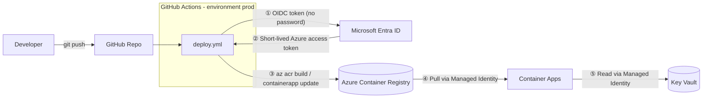

# 🔐 Azure Secretless CI/CD Hands-on Lab

🌐 [한국어](README.md) | **English**

> **Not "how to store secrets safely" — but "how to get rid of secrets entirely."**

Build a GitHub Actions CI/CD pipeline that deploys to Azure, and an app running on top of it, **without any passwords, keys, or connection strings (Secretless)**.

| | |
|---|---|
| ⏱ Duration | About 90 minutes (excluding prerequisites) |
| 🎯 Level | Beginner to intermediate |
| 💰 Estimated cost | Under $1 for the lab session (clean up when done!) |
| 🌏 Region | Korea Central (configurable) |

## 🧭 What will you build?



**Three places where secrets disappear**

| Path | Traditional (with secrets) ❌ | This lab (Secretless) ✅ |
|---|---|---|
| GitHub Actions → Azure | Service Principal client secret stored in GitHub Secrets (expiry & leak risk) | **OIDC Federated Credential** — a one-time token per run |
| Container Apps → ACR | Registry admin username/password | **Managed Identity + AcrPull** |
| App → Key Vault | Client ID/secret in environment variables | **Managed Identity + Key Vault Secrets User** |

## 📚 Modules

| # | Module | Time | Key concepts |
|---|---|---|---|
| 0 | [Prerequisites](docs/en/00-prerequisites.md) | 10 min | Tools, fork, sign-in |
| 1 | [Why Secretless?](docs/en/01-concepts.md) | 10 min | Problems with secrets, OIDC, Managed Identity |
| 2 | [Deploy infrastructure (Bicep)](docs/en/02-deploy-infra.md) | 15 min | IaC, RBAC, Managed Identity |
| 3 | [Connect GitHub ↔ Azure with OIDC](docs/en/03-setup-oidc.md) | 15 min | Federated Credential, subject |
| 4 | [Run the CI/CD pipeline](docs/en/04-pipeline.md) | 15 min | `id-token: write`, azure/login |
| 5 | [Verify & break it](docs/en/05-verify-and-break.md) | 20 min | Learn by breaking things on purpose |
| 6 | [Cleanup](docs/en/06-cleanup.md) | 5 min | Avoid costs |
| ➕ | [Troubleshooting](docs/en/troubleshooting.md) · [Instructor guide](docs/en/instructor-guide.md) | | |

## 🗂 Repository layout

```
.
├── app/                    # Node.js sample app (uses DefaultAzureCredential)
├── infra/main.bicep        # ACR, Key Vault, Container Apps, Managed Identity, RBAC
├── scripts/
│   ├── 01-deploy-infra.sh  # Deploy infrastructure
│   ├── 02-setup-oidc.sh    # Set up OIDC (Federated Credential)
│   └── 03-cleanup.sh       # Cleanup
├── .github/workflows/
│   ├── ci.yml              # PR/branch validation (no Azure access)
│   └── deploy.yml          # Deploy from main (OIDC login)
├── .devcontainer/          # Codespaces environment (az, gh, node included)
└── docs/                   # Lab guides (Korean) — English guides are in docs/en/
```

## 🚀 Getting started

1. **Fork** this repository (top-right `Fork`).
2. In your fork, choose **Code ▸ Codespaces ▸ Create codespace** (no local tool installation needed).
3. Start with [Module 0. Prerequisites](docs/en/00-prerequisites.md).

## ✅ What you'll take away

- A deployment pipeline with **zero Azure credentials** in GitHub Secrets
- The ability to explain what a Federated Credential `subject` trusts
- A pattern for service-to-service access using Managed Identity + Azure RBAC
- The skills to diagnose sign-in and permission errors on your own
