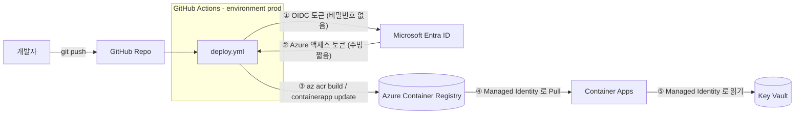

# 🔐 Azure Secretless CI/CD Hands-on Lab

> **"시크릿을 안전하게 보관하는 방법"이 아니라, 아예 "시크릿을 없애는 방법"을 배웁니다.**

GitHub Actions로 Azure에 배포하는 CI/CD 파이프라인과, 그 위에서 동작하는 앱을 **비밀번호·키·연결 문자열 없이(Secretless)** 구성합니다.

| | |
|---|---|
| ⏱ 소요 시간 | 약 90분 (사전 준비 제외) |
| 🎯 난이도 | 초급 ~ 중급 |
| 💰 예상 비용 | 실습 시간 동안 1달러 미만 (끝나면 반드시 정리) |
| 🌏 리전 | Korea Central (변경 가능) |

## 🧭 무엇을 만드나요?



**시크릿이 사라지는 3개 지점**

| 구간 | 기존 방식 (Secret 있음) ❌ | 이번 실습 (Secretless) ✅ |
|---|---|---|
| GitHub Actions → Azure | Service Principal 클라이언트 시크릿을 GitHub Secrets에 저장 (만료·유출 위험) | **OIDC Federated Credential** — 실행 때마다 일회용 토큰 |
| Container Apps → ACR | 레지스트리 admin 사용자/비밀번호 | **Managed Identity + AcrPull** |
| 앱 → Key Vault | 클라이언트 ID/시크릿 환경변수 | **Managed Identity + Key Vault Secrets User** |

## 📚 실습 순서

| # | 모듈 | 시간 | 핵심 개념 |
|---|---|---|---|
| 0 | [사전 준비](docs/00-prerequisites.md) | 10분 | 도구, Fork, 로그인 |
| 1 | [왜 Secretless 인가?](docs/01-concepts.md) | 10분 | 시크릿의 문제, OIDC, Managed Identity |
| 2 | [인프라 배포 (Bicep)](docs/02-deploy-infra.md) | 15분 | IaC, RBAC, Managed Identity |
| 3 | [GitHub ↔ Azure OIDC 연결](docs/03-setup-oidc.md) | 15분 | Federated Credential, subject |
| 4 | [CI/CD 파이프라인 실행](docs/04-pipeline.md) | 15분 | `id-token: write`, azure/login |
| 5 | [검증 & 장애 체험](docs/05-verify-and-break.md) | 20분 | 일부러 깨뜨려 보며 이해하기 |
| 6 | [정리 (Cleanup)](docs/06-cleanup.md) | 5분 | 비용 방지 |
| ➕ | [트러블슈팅](docs/troubleshooting.md) · [진행자 가이드](docs/instructor-guide.md) | | |

## 🗂 저장소 구조

```
.
├── app/                    # Node.js 샘플 앱 (DefaultAzureCredential 사용)
├── infra/main.bicep        # ACR, Key Vault, Container Apps, Managed Identity, RBAC
├── scripts/
│   ├── 01-deploy-infra.sh  # 인프라 배포
│   ├── 02-setup-oidc.sh    # OIDC(Federated Credential) 설정
│   └── 03-cleanup.sh       # 정리
├── .github/workflows/
│   ├── ci.yml              # PR/브랜치 검증 (Azure 접근 없음)
│   └── deploy.yml          # main 배포 (OIDC 로그인)
├── .devcontainer/          # Codespaces 환경 (az, gh, node 포함)
└── docs/                   # 실습 가이드
```

## 🚀 시작하기

1. 이 저장소를 **Fork** 합니다 (우측 상단 `Fork`).
2. Fork한 저장소에서 **Code ▸ Codespaces ▸ Create codespace** 를 선택합니다 (로컬 도구 설치 불필요).
3. [모듈 0. 사전 준비](docs/00-prerequisites.md)부터 따라 합니다.

## ✅ 실습 후 얻는 것

- GitHub Secrets에 **Azure 자격 증명이 0개**인 배포 파이프라인
- Federated Credential의 `subject` 가 무엇을 신뢰하는지 설명할 수 있음
- Managed Identity + Azure RBAC로 서비스 간 접근을 구성하는 패턴
- 문제가 생겼을 때 로그인/권한 오류를 스스로 진단하는 능력
