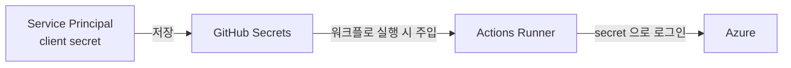
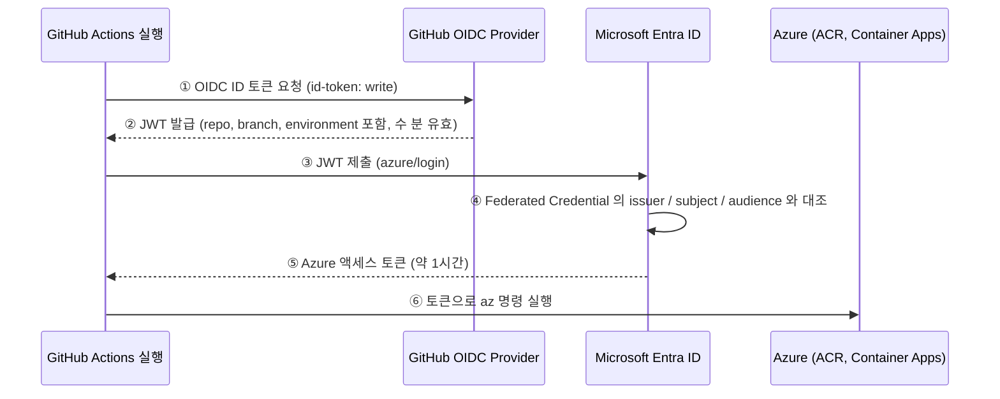
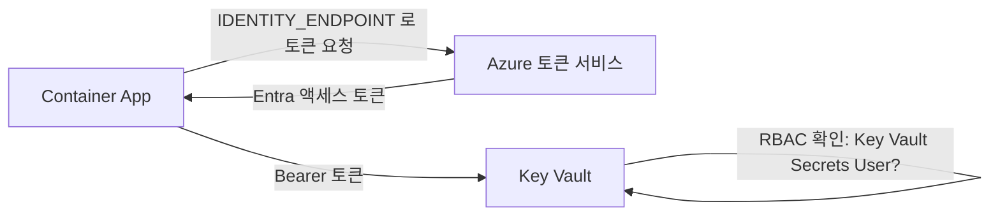

# 모듈 1. 왜 Secretless 인가? (10분)

실습 전에 핵심 개념 3가지만 잡고 갑니다.

## 1. 시크릿이 있으면 생기는 문제

기존 방식: Service Principal을 만들고 **클라이언트 시크릿**을 GitHub Secrets(`AZURE_CREDENTIALS`)에 저장.

| 문제 | 설명 |
|---|---|
| 유출 위험 | 로그, 포크 PR, 서드파티 Action, 퇴사자 등을 통해 샐 수 있음 |
| 만료 관리 | 6개월/1년마다 갱신하지 않으면 **어느 날 갑자기 배포가 깨짐** |
| 수명이 김 | 한 번 유출되면 만료 때까지(또는 수동 폐기 전까지) 어디서든 사용 가능 |
| 추적 곤란 | 누가 그 시크릿으로 로그인했는지 구분하기 어려움 |

## 2. OIDC (Workload Identity Federation)

**"비밀번호를 주는 대신, 신원을 증명하는 일회용 토큰을 주고받는다."**

④ 에서 Entra ID가 확인하는 3가지:

| 항목 | 값 (이 실습) | 의미 |
|---|---|---|
| `issuer` | `https://token.actions.githubusercontent.com` | GitHub이 발급한 토큰인가 |
| `subject` | `repo:<owner>/<repo>:environment:prod` | **어떤 저장소의 어떤 환경**에서 실행된 것인가 |
| `audience` | `api://AzureADTokenExchange` | Azure 토큰 교환용으로 발급된 토큰인가 |

> 🔑 **저장되는 비밀이 없습니다.** GitHub에 저장하는 `client-id`, `tenant-id`, `subscription-id` 는 단순 식별자라서 `Secrets`가 아닌 `Variables`에 둬도 됩니다.
> 토큰은 매 실행마다 새로 만들어지고 금방 만료됩니다.

`subject` 는 신뢰 범위를 정하는 **가장 중요한 보안 설정**입니다.

| subject 예시 | 신뢰 범위 |
|---|---|
| `repo:org/repo:environment:prod` | `prod` 환경 job 만 (이 실습, 환경 승인 규칙과 결합 가능) |
| `repo:org/repo:ref:refs/heads/main` | `main` 브랜치에서 실행된 job |
| `repo:org/repo:pull_request` | PR 에서 실행된 job (⚠️ 권한은 최소로!) |

## 3. Managed Identity

Azure 리소스(Container Apps 등)에 **Azure가 자격 증명을 대신 관리**하는 신원을 붙여 주는 기능입니다.

- 비밀번호가 **존재하지 않고**, 자동 교체됩니다.
- 접근 권한은 **Azure RBAC** 역할 할당으로 제어합니다 (최소 권한 원칙).
- 코드에서는 `DefaultAzureCredential()` 한 줄이면 됩니다. 로컬 개발 땐 `az login` 계정이 자동 사용됩니다.

| 종류 | 설명 | 이 실습 |
|---|---|---|
| System-assigned | 리소스와 수명을 같이함 | – |
| **User-assigned** | 독립적으로 생성, 여러 리소스에서 공유 가능. **앱보다 먼저 만들어 권한을 줄 수 있음** | ✅ 앱 신원 / 배포 신원 |

## 이번 실습에서 만드는 신원 2개

| 신원 | 누가 쓰나 | 인증 방식 | 권한 |
|---|---|---|---|
| `secretless-id-github` | GitHub Actions (배포 시) | **OIDC Federated Credential** | RG `Contributor` |
| `secretless-id-app` | Container App (런타임) | **Managed Identity** | ACR `AcrPull`, Key Vault `Secrets User` |

> 배포 신원과 런타임 신원을 **분리**하는 것이 중요합니다. 앱이 탈취돼도 배포 권한이 따라가지 않습니다.

## ✅ 체크포인트 질문

1. 클라이언트 시크릿이 없는데 Azure는 GitHub Actions가 누구인지 어떻게 알까요?
2. `subject` 를 `repo:*` 처럼 넓게 잡으면 어떤 위험이 있을까요?
3. `client-id` 가 노출되면 누군가 내 Azure에 로그인할 수 있을까요? (힌트: 토큰은 누가 발급하나요?)

다음: [모듈 2. 인프라 배포](02-deploy-infra.md)
