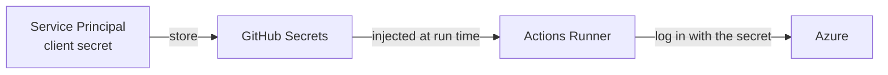
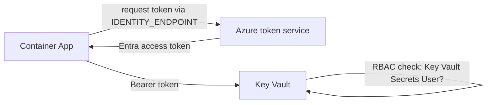

# Module 1. Why Secretless? (10 min)

Let's lock in three key concepts before the hands-on part.

## 1. The problem with having secrets

The traditional way: create a Service Principal and store its **client secret** in GitHub Secrets (`AZURE_CREDENTIALS`).



| Problem | Description |
|---|---|
| Leak risk | Can leak through logs, fork PRs, third-party Actions, departing employees, etc. |
| Expiry management | If not renewed every 6–12 months, deployments **suddenly break one day** |
| Long-lived | Once leaked, usable from anywhere until it expires (or is manually revoked) |
| Hard to trace | Difficult to tell who signed in with that shared secret |

## 2. OIDC (Workload Identity Federation)

**"Instead of handing over a password, exchange one-time tokens that prove identity."**

```mermaid
sequenceDiagram
    participant WF as GitHub Actions run
    participant GH as GitHub OIDC Provider
    participant EN as Microsoft Entra ID
    participant AZ as Azure (ACR, Container Apps)
    WF->>GH: ① Request OIDC ID token (id-token: write)
    GH-->>WF: ② Issue JWT (contains repo, branch, environment; valid for minutes)
    WF->>EN: ③ Present the JWT (azure/login)
    EN->>EN: ④ Compare with the Federated Credential's issuer / subject / audience
    EN-->>WF: ⑤ Azure access token (about 1 hour)
    WF->>AZ: ⑥ Run az commands with the token
```

What Entra ID verifies in step ④:

| Item | Value (this lab) | Meaning |
|---|---|---|
| `issuer` | `https://token.actions.githubusercontent.com` | Was the token issued by GitHub? |
| `subject` | `repo:<owner>/<repo>:environment:prod` | **Which repository and which environment** ran the job? |
| `audience` | `api://AzureADTokenExchange` | Was the token issued for Azure token exchange? |

> 🔑 **There is no stored secret.** The `client-id`, `tenant-id`, and `subscription-id` stored in GitHub are plain identifiers, so they can go in `Variables` instead of `Secrets`.
> Tokens are created fresh on every run and expire quickly.

The `subject` is the **most important security setting** because it defines the scope of trust.

| Example subject | Trust scope |
|---|---|
| `repo:org/repo:environment:prod` | Only jobs in the `prod` environment (this lab; can be combined with approval rules) |
| `repo:org/repo:ref:refs/heads/main` | Jobs run on the `main` branch |
| `repo:org/repo:pull_request` | Jobs run from PRs (⚠️ keep permissions minimal!) |

## 3. Managed Identity

A feature that gives an Azure resource (e.g. Container Apps) an identity whose **credentials are managed by Azure itself**.



- There is **no password to begin with**, and credentials rotate automatically.
- Access is controlled with **Azure RBAC** role assignments (least privilege).
- In code, a single `DefaultAzureCredential()` is enough. For local development, your `az login` account is used automatically.

| Type | Description | This lab |
|---|---|---|
| System-assigned | Shares the lifecycle of the resource | – |
| **User-assigned** | Created independently, shareable across resources. **Can be created before the app so permissions are granted first** | ✅ App identity / deploy identity |

## The two identities we create

| Identity | Used by | Authentication | Permissions |
|---|---|---|---|
| `secretless-id-github` | GitHub Actions (at deploy time) | **OIDC Federated Credential** | `Contributor` on the RG |
| `secretless-id-app` | Container App (at runtime) | **Managed Identity** | ACR `AcrPull`, Key Vault `Secrets User` |

> **Separating** the deploy identity from the runtime identity is important. If the app is compromised, deploy permissions don't come along.

## ✅ Checkpoint questions

1. There is no client secret — so how does Azure know who GitHub Actions is?
2. What's the risk if you make the `subject` broad, like `repo:*`?
3. If the `client-id` is exposed, can someone sign in to your Azure? (Hint: who issues the token?)

Next: [Module 2. Deploy infrastructure](02-deploy-infra.md)
